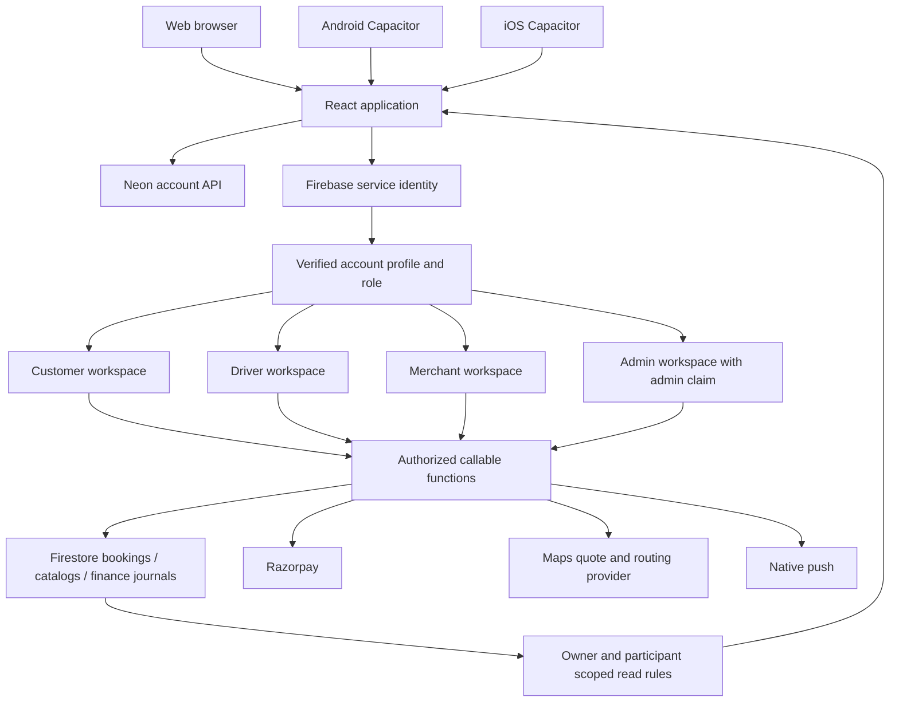

# AllGo platform connections

## Current source architecture

The account API and Firebase service identity are separate systems. A local account session alone does not authorize Firestore, callable functions or native providers. Client navigation and presentation must never grant roles or replace these checks.

## Integration gaps and release gates

1. New combined bookings are disabled: production catalog/place selection and driver/merchant bundle queues are not integrated or accepted. Existing owner-scoped journey history can be reopened from Activity.
2. Bundle cancellation now records a durable refund intent before provider I/O (`functions/bundleRefunds.js`). Bundle/leg-scoped keys replace colliding leg-only journals and invalid provider keys. Only matching processed provider evidence posts a journal; pending/uncertain outcomes remain in reconciliation. Live provider and operational failure acceptance remain required before enabling combined journeys.
3. The bundle visualization is a status diagram, not a geographic map. Location records do not establish fresh GPS. Actual authorized map integration and stale-coordinate handling remain required.
4. Android and iOS native Firebase registrations/configuration are missing. Development sync intentionally omits those plugins. Successful sync or Android compilation does not verify native Google/Apple/phone login or push.
5. Signing, live staging/provider configuration, business policies and end-to-end service fulfillment are not accepted. iOS must be compiled and tested with Xcode on macOS; Windows cannot provide that evidence.
6. Foreground/native back handling exists; full guarded browser route ownership and deep-link coverage across roles and combined journeys remain incomplete.
7. Private partner document intake and review exist; operational role activation, merchant eligibility, fleet flows and remaining grocery/parcel service operations still need the original audit work.

## Current increment

- Reusable customer navigation and service tiles, shared role workspace sizing and design tokens.
- Owner-scoped paginated combined journey history (30 per page), with refresh, request generation guards and explicit load failures. Requires the new Firestore composite index to be deployed to staging.
- Tracking listeners clear data on journey switches, ignore late callbacks after teardown, surface leg read failures and time out a stalled initial parent read.
- Removed unverified geographic tracking, automatic refund and 24-hour support promises from the bundle interface.

Production readiness remains unverified. Every gate above requires implementation or real acceptance evidence.
