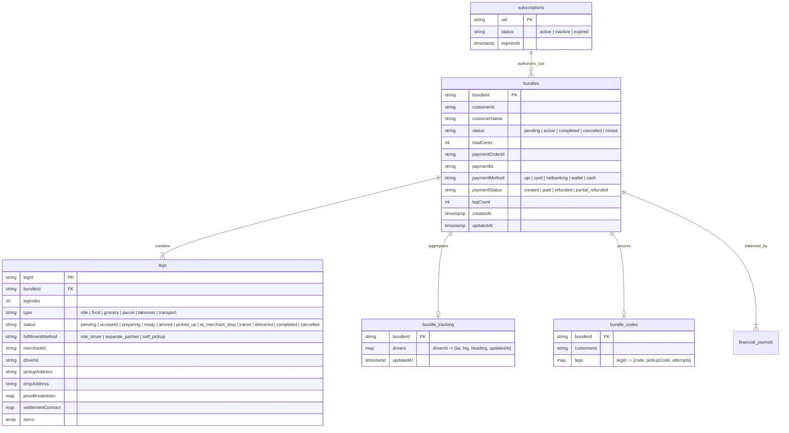
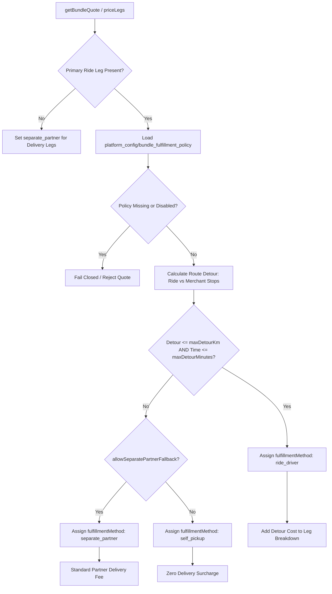
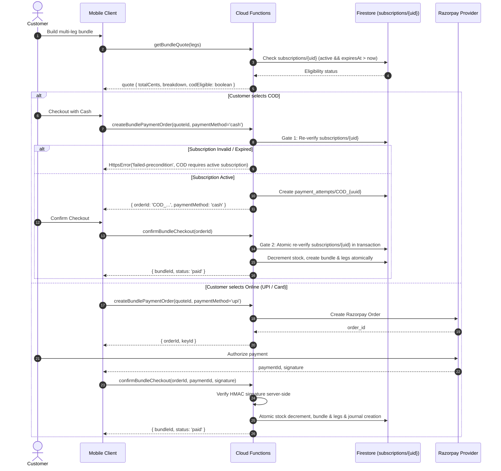

# Unified Trip Bundle Architecture

## 1. Overview
The **Unified Trip Bundle** architecture allows an AllGo customer to combine multiple services—specifically a ride with food and grocery orders—into a single customer booking journey with a unified quote, single checkout, single payment attempt, and live synchronized tracking across all legs.

Fulfillment combines driver en-route detours (where the assigned ride driver makes a merchant stop to pick up food or grocery items) with fallback to separate partner dispatch or customer self-pickup when detours exceed operator-configured policy limits.

---

## 2. Data Model

### Collection Security Invariants
- `bundles/{bundleId}`: Customers can read only their own bundles. Drivers and merchants cannot directly query root `bundles/` directly. Writes are denied to all clients (server callables and triggers only).
- `bundles/{bundleId}/legs/{legId}`: Sibling leg privacy is strictly enforced. An assigned driver or merchant can only read the leg assigned to them; they cannot read sibling legs, passenger phone numbers, or sibling OTPs.
- `bundle_tracking/{bundleId}`: Customers can read live driver coordinates for their active bundle. Drivers update their location via trusted server callable `updateDriverLocation`.
- `bundle_codes/{bundleId}`: Contains raw customer delivery OTPs and merchant handover OTPs. Strictly isolated from client read access; verified via `confirmDetourPickup` and driver fulfillment callables.

---

## 3. Fulfillment Decision Flow

Operator configuration in `platform_config/bundle_fulfillment_policy`:
- `enabled`: boolean gate (fails closed if false or document missing)
- `maxDetourKm`: maximum extra distance allowed for ride driver detour (e.g. 5.0 km)
- `maxDetourMinutes`: maximum extra travel duration allowed (e.g. 15 min)
- `detourCostPerKm`: rate per detour kilometer in paise (e.g. 500 paise/km)
- `allowDriverPickup`: boolean allowing ride driver to fulfill merchant pickups
- `separatePartnerDeadlineMinutes`: timeout for detour before reassigning to standalone delivery partner

---

## 4. Cash On Delivery (COD) Gate Flow

Cash on Delivery is exclusively gated behind an active **AllGo Plus** subscription (`subscriptions/{uid}`). Client-supplied values are never trusted.

---

## 5. Per-Leg Refund Ledger Invariant

Partial leg cancellations (e.g. cancelling a grocery leg while keeping the ride and restaurant order) are processed independently:
1. **Idempotency Key**: Derived as `${bundle.paymentId}:leg:${legId}`.
2. **Provider Refund**: If paid online, a partial Razorpay refund is issued with the header `X-Refund-Idempotency`.
3. **Financial Journal**: A balanced entry is recorded at `financial_journals/leg_refund_{legId}`. The existence of this document prevents duplicate refunds on retry.
4. **Stock Restoration**: Grocery item quantities are atomically restored using `recordStockMovement(tx, prodRef, ..., 'return', ...)`.

### Zero-Balance Ledger Invariant
At terminal state (all legs completed, delivered, or cancelled):
$$\sum \text{Debit Cents} - \sum \text{Credit Cents} = 0$$
- Capture Journal: Debits `provider_clearing` (or `cash_in_transit`), Credits `booking_funds_unallocated`.
- Per-Leg Refund Journal: Debits `booking_funds_unallocated`, Credits `provider_clearing`.
- Leg Settlement: Debits `booking_funds_unallocated`, Credits `driver_payable` and `merchant_payable`.

---

## 6. Migration Strategy
Legacy bookings created via legacy endpoints (`bookings/{bookingId}`) remain readable and operable by legacy workflows.
The callable `migrateLegacyBookingToBundle` allows zero-downtime, idempotent migration:
- **Dry-run mode (`dryRun: true`)**: Validates legacy records, computes derived bundle statuses, and returns transformation results without writing to Firestore.
- **Migration mode**: Creates a 1-leg `bundles/{BND_id}` parent and `legs/{LEG_id_0}` child, updates `bookings/{bookingId}.bundleId`, and logs audit records.
- **Idempotency**: Already-migrated bookings are skipped without re-writing.
