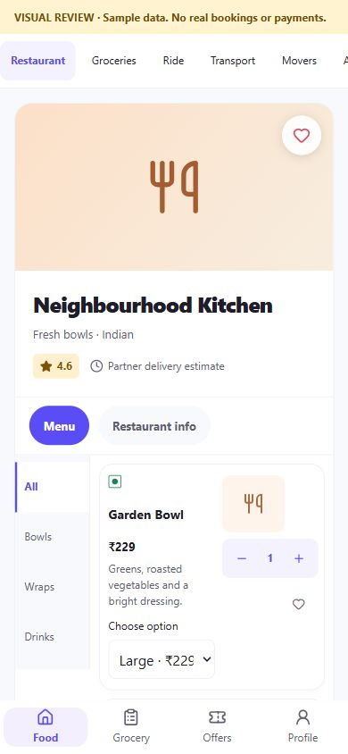
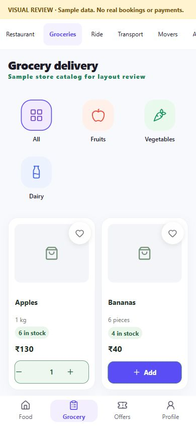
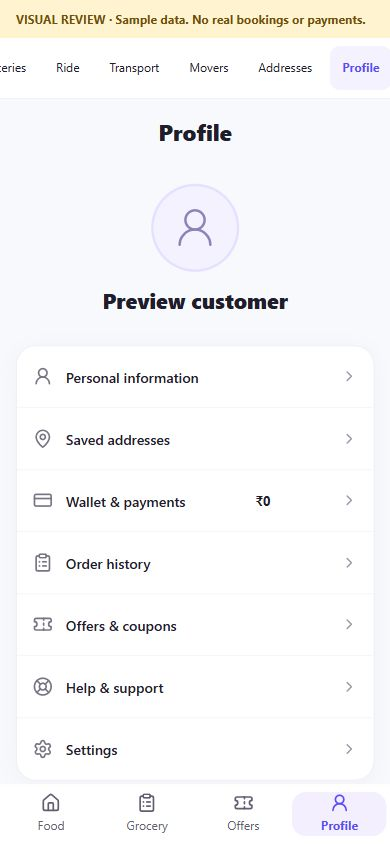

# Stitch delivery app UI redesign

Date: 13 October 2026  
Source: `C:\Users\loges\Downloads\stitch_on_demand_delivery_app_ui.zip` (12 Stitch screens and matching HTML; 25 files inventoried in `inventory.json`).

The supplied screenshots and HTML were used as design references. Their sample prices, names, phone numbers, maps, offers, vendor marks, and photos were not treated as real app data. The redesign reuses the existing AllGo customer, catalog, address, service quote, cart, profile, and support handlers. The standalone `?review=stitch` screen is a development-only visual gallery with clearly labeled fixtures; it has no checkout, booking, authentication, address lookup, or payment actions.

## Reference coverage

| Stitch screen | App change | Data and behavior |
| --- | --- | --- |
| Splash | White/orange AllGo welcome with the supplied inline rider illustration | Existing Get Started and sign-in transitions |
| Login / sign up | Branded sign-in layout with avatar illustration | Existing email and configured native-phone flows; provider availability gates are retained |
| Location setup | Restyled first-run location surface and responsive layout | Existing location permission and picker behavior |
| Edit address | Full-screen address sheet, saved-address selector and address form | Existing add/default/delete operations and Google location lookup. There is no address-edit API, so no edit action is claimed |
| Restaurant menu | Partner hero, category rail, menu rows, real variant selector and cart quantity | Live restaurant/menu records, prices, stock/availability, saved items, details and cart handlers |
| Grocery home | Illustrated categories sourced from current catalog categories and simplified store rows | Live categories and partner catalog |
| Grocery products | Two-column catalog cards with stock-aware add and quantity controls | Live product price, unit, stock and cart logic |
| Ride booking | Bike/Auto/Car selection rows | Existing class selection and server quote flow; no displayed sample fare or ETA |
| Bike transport | Supplied motorcycle illustration and restyled quote steps | Existing transport class, server quotes, expiry checks and payment handoff |
| Packers & movers | A readable planned-service screen with disabled requirements and support entry | Moving quotes and booking are not available in the current app |
| Offers & coupons | Coupon entry and browse links | Codes are checked against the active cart by existing validation. There is no public verified-offer feed or fabricated discount |
| Profile | Customer identity and grouped account actions | Current user fields and existing account routes; no default identity or wallet balance |

## Review captures

These phone-sized captures show the development gallery's sample data. They demonstrate the presentation and interaction states, not an authenticated production session.

## Validation

The visual gallery was inspected at 390 × 844. The restaurant variant updates its price and quantity controls, out-of-stock groceries remain disabled, ride class is selectable, the address form validates locally without location lookup or saving, and the offers page disables cart review when the cart is empty. The Movers screen states that booking and quotes are unavailable.

Validation logs in this directory record TypeScript lint, the full unit/integration test command, Vite build, and Android Capacitor sync. A local Android debug compile and real device/service acceptance are separate checks. Native Firebase phone sign-in still depends on the user's configured provider and platform credentials.
